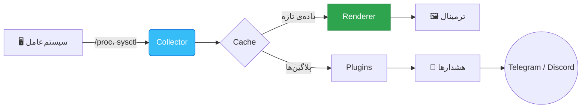
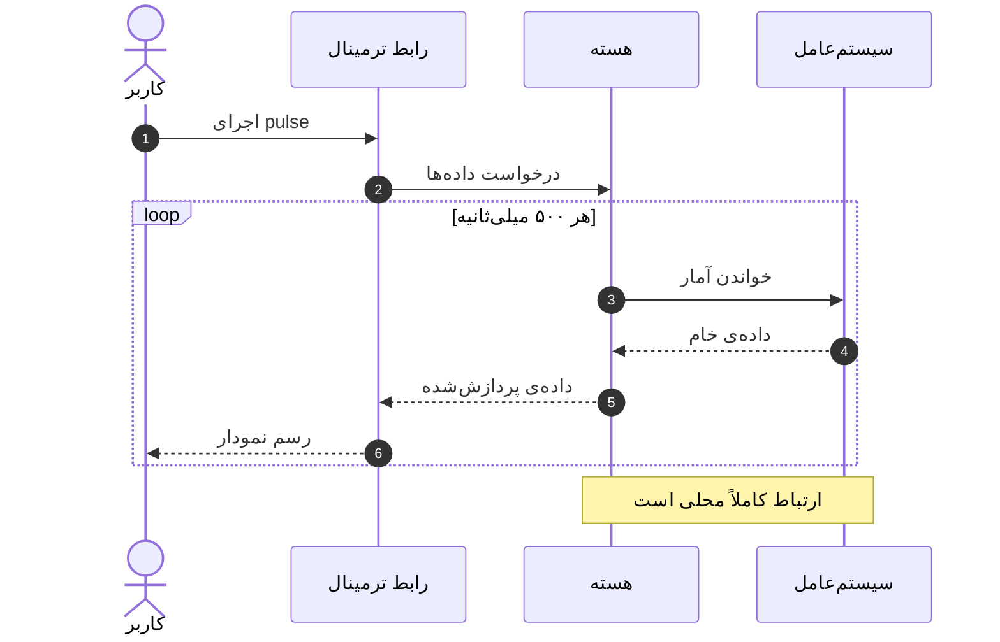
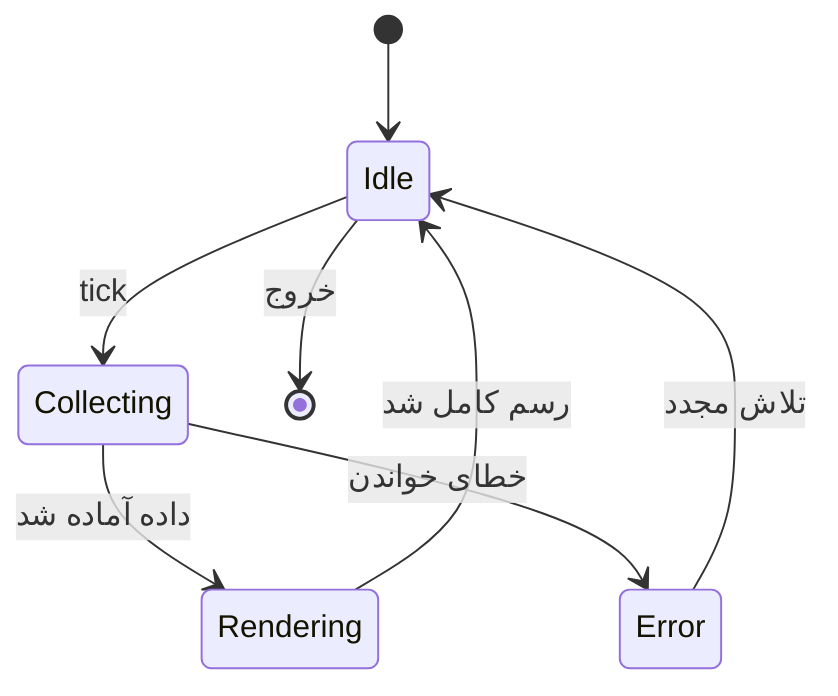
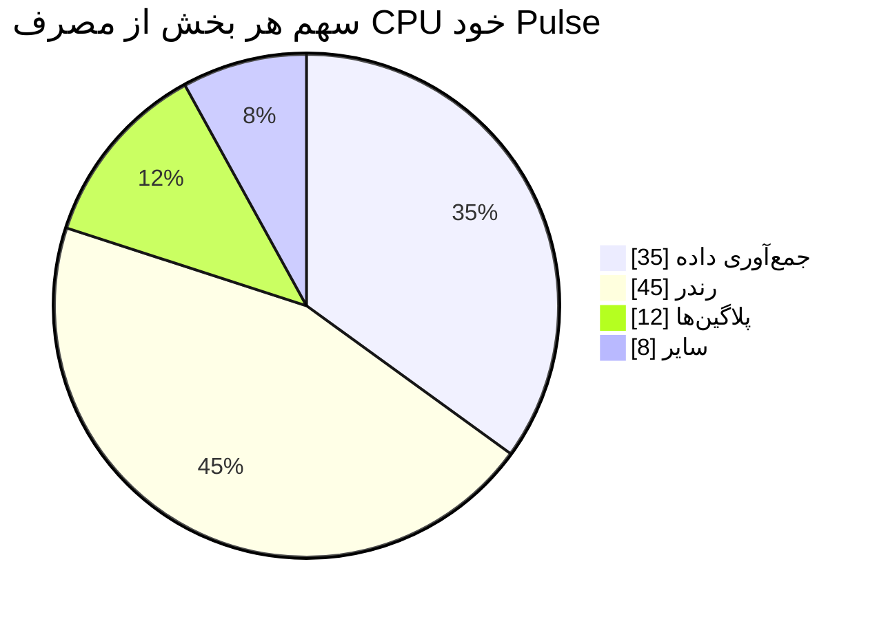
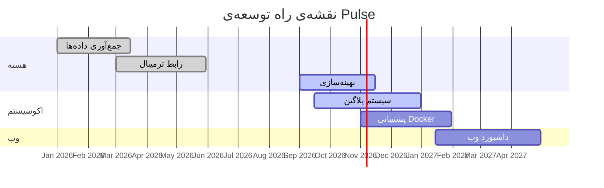
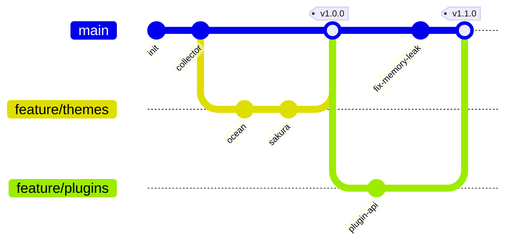

<!-- این یک کامنت مخفیه که در صفحه‌ی گیت‌هاب دیده نمی‌شه 🙈 -->

<div align="center" markdown="1">


<a href="https://github.com/your-username/pulse">
  
</a>

<br/>

[](https://github.com/your-username/pulse/releases)
[](https://github.com/your-username/pulse/actions)
[](https://go.dev)
[](LICENSE)

[](https://github.com/your-username/pulse/stargazers)
[](https://github.com/your-username/pulse/network/members)


<br/>

<picture>
  <source media="(prefers-color-scheme: dark)" srcset="https://placehold.co/900x400/0d1117/36BCF7?text=Pulse+%7C+Dark+Mode&font=montserrat">
  <source media="(prefers-color-scheme: light)" srcset="https://placehold.co/900x400/ffffff/0969da?text=Pulse+%7C+Light+Mode&font=montserrat">
  
</picture>

<br/><br/>

**[🚀 شروع سریع](#-quickstart)** &nbsp;•&nbsp;
**[✨ قابلیت‌ها](#-features)** &nbsp;•&nbsp;
**[📖 مستندات](#-usage)** &nbsp;•&nbsp;
**[🗺️ نقشه راه](#-roadmap)** &nbsp;•&nbsp;
**[🤝 مشارکت](#-contributing)**

</div>

<div dir="rtl" markdown="1">

<a name="top"></a>

> [!NOTE]
> این پروژه برای نمایش **تمام قابلیت‌های Markdown در گیت‌هاب** ساخته شده؛ هر بخش یک امکان متفاوت رو نشون می‌ده. می‌تونی اسمش رو عوض کنی و ازش به‌عنوان قالب README استفاده کنی. 🎨

---

## 📑 فهرست مطالب

- [💡 درباره‌ی پروژه](#-about)
- [✨ قابلیت‌ها](#-features)
- [🚀 شروع سریع](#-quickstart)
- [📖 نحوه‌ی استفاده](#-usage)
- [🏗️ معماری](#-architecture)
- [📊 بنچمارک](#-benchmarks)
- [🧮 فرمول‌ها](#-math)
- [⌨️ میان‌برهای کیبورد](#-shortcuts)
- [🎨 تم‌ها](#-themes)
- [🗺️ نقشه راه](#-roadmap)
- [❓ سوالات متداول](#-faq)
- [🤝 مشارکت](#-contributing)
- [👥 مشارکت‌کنندگان](#-contributors)
- [📜 مجوز](#-license)

---

<a name="-about"></a>
## 💡 درباره‌ی پروژه

**Pulse** یک مانیتور سیستم متن‌بازه که با زبان *Go* نوشته شده و اطلاعات **CPU**، **RAM**، **دیسک**، **شبکه** و **پروسس‌ها** رو به‌صورت لحظه‌ای و در یک رابط ترمینالی زیبا نشون می‌ده.

چرا Pulse؟

1. ⚡ **سریع** — مصرف کمتر از ~~۵۰ مگابایت~~ **۸ مگابایت** رم
2. 📦 **تک‌فایل** — بدون هیچ وابستگی؛ فقط دانلود و اجرا
3. 🎨 **زیبا** — تم‌های متنوع و نمودارهای زنده
4. 🔌 **قابل‌توسعه** — سیستم پلاگین با `Go` و `Lua`

> “ابزاری که باید حواست بهش باشه، ابزار خوبی نیست.”
>
> — فلسفه‌ی طراحی Pulse

H<sub>2</sub>O و E = mc<sup>2</sup> هم از نوشتن بالانویس و زیرنویس پشتیبانی می‌کنن. ✍️

<p align="left"><a href="#top">⬆️ بازگشت به بالا</a></p>

---

<a name="-features"></a>
## ✨ قابلیت‌ها

| قابلیت | توضیحات | وضعیت |
| :--- | :---: | ---: |
| 📈 نمودار زنده‌ی CPU | به‌روزرسانی هر ۱۰۰ms | ✅ پایدار |
| 🧠 مانیتور حافظه | RAM، Swap و Cache | ✅ پایدار |
| 💽 آمار دیسک | خواندن/نوشتن و فضای آزاد | ✅ پایدار |
| 🌐 ترافیک شبکه | سرعت آپلود و دانلود هر اینترفیس | ✅ پایدار |
| 🔥 دمای سخت‌افزار | CPU / GPU / NVMe | 🧪 آزمایشی |
| 🐳 پشتیبانی Docker | آمار کانتینرها | 🚧 در حال توسعه |
| 🔔 هشدارها | ارسال به Telegram و Discord | 📅 برنامه‌ریزی شده |

### وضعیت پیاده‌سازی

- [x] نمایش CPU و RAM
- [x] پشتیبانی از Linux، macOS و Windows
- [x] تم‌های سفارشی
- [ ] سیستم پلاگین
- [ ] داشبورد وب
  - [x] طراحی اولیه
  - [ ] پیاده‌سازی API
  - [ ] نسخه‌ی موبایل

<details markdown="1">
<summary><b>🔍 جزئیات بیشتر درباره‌ی قابلیت‌ها (برای باز شدن کلیک کن)</b></summary>

<br/>

- **اندازه‌گیری دقیق:** داده‌ها مستقیم از `/proc` و `sysfs` (در لینوکس) و `sysctl` (در macOS) خونده می‌شن.
- **کم‌مصرف:** حلقه‌ی رندر فقط وقتی تغییری باشه صفحه رو بازنقاشی می‌کنه.
- **ریسپانسیو:** رابط کاربری با تغییر اندازه‌ی ترمینال خودش رو تنظیم می‌کنه.

> [!TIP]
> با ست کردن `PULSE_FPS=60` نمودارها نرم‌تر می‌شن، اما مصرف CPU کمی بالا می‌ره.

</details>

<details open markdown="1">
<summary><b>🎁 این بخش به‌صورت پیش‌فرض بازه</b></summary>

<br/>

یه‌بار نصب، همه‌جا اجرا. Pulse روی **Raspberry Pi** هم بدون مشکل کار می‌کنه! 🍓

</details>

<p align="left"><a href="#top">⬆️ بازگشت به بالا</a></p>

---

<a name="-quickstart"></a>
## 🚀 شروع سریع

### پیش‌نیازها

> [!IMPORTANT]
> برای ساخت از سورس به **Go 1.22** یا بالاتر نیاز دارید.

### نصب

<table>
<tr>
<td markdown="1">

**🍺 Homebrew**

</td>
<td markdown="1">

```bash
brew install your-username/tap/pulse
```

</td>
</tr>
<tr>
<td markdown="1">

**🐹 Go**

</td>
<td markdown="1">

```bash
go install github.com/your-username/pulse@latest
```

</td>
</tr>
<tr>
<td markdown="1">

**🐧 اسکریپت نصب**

</td>
<td markdown="1">

```bash
curl -fsSL https://pulse.dev/install.sh | sh
```

</td>
</tr>
<tr>
<td markdown="1">

**🪟 Scoop**

</td>
<td markdown="1">

```powershell
scoop install pulse
```

</td>
</tr>
<tr>
<td markdown="1">

**🐳 Docker**

</td>
<td markdown="1">

```bash
docker run --rm -it --pid=host ghcr.io/your-username/pulse
```

</td>
</tr>
</table>

### ساخت از سورس

```bash
# کلون کردن مخزن
git clone https://github.com/your-username/pulse.git
cd pulse

# ساخت
make build

# اجرا
./bin/pulse
```

> [!WARNING]
> در ویندوز، برای دسترسی به اطلاعات دمای سخت‌افزار باید برنامه را با دسترسی **Administrator** اجرا کنید.

<p align="left"><a href="#top">⬆️ بازگشت به بالا</a></p>

---

<a name="-usage"></a>
## 📖 نحوه‌ی استفاده

### اجرای ساده

```bash
pulse
```

### پرچم‌ها (Flags)

```text
Usage: pulse [options]

Options:
  -t, --theme <name>     انتخاب تم (default: ocean)
  -r, --refresh <ms>     فاصله‌ی به‌روزرسانی (default: 500)
  -c, --config <path>    مسیر فایل پیکربندی
      --no-color         غیرفعال کردن رنگ‌ها
  -v, --version          نمایش نسخه
  -h, --help             راهنما
```

### فایل پیکربندی

```yaml
# ~/.config/pulse/config.yml
theme: ocean
refresh: 500   # میلی‌ثانیه

widgets:
  - cpu
  - memory
  - network
  - disk

alerts:
  cpu_threshold: 90
  notify: telegram
```

### استفاده به‌عنوان کتابخانه

```go
package main

import (
	"fmt"
	"time"

	"github.com/your-username/pulse/pkg/stats"
)

func main() {
	for range time.Tick(time.Second) {
		cpu, _ := stats.CPUPercent()
		mem, _ := stats.Memory()
		fmt.Printf("CPU: %.1f%% | RAM: %d MB\n", cpu, mem.UsedMB)
	}
}
```

### خروجی JSON

```json
{
  "timestamp": "2026-10-10T12:00:00Z",
  "cpu": { "percent": 23.5, "cores": 8 },
  "memory": { "used_mb": 4096, "total_mb": 16384 },
  "network": { "rx_kbps": 120.4, "tx_kbps": 34.9 }
}
```

### تغییرات پیکربندی (diff)

```diff
- refresh: 1000
+ refresh: 250
- theme: classic
+ theme: ocean
```

<p align="left"><a href="#top">⬆️ بازگشت به بالا</a></p>

---

<a name="-architecture"></a>
## 🏗️ معماری

### نمای کلی



### چرخه‌ی یک درخواست



### ساختار پوشه‌ها

```text
pulse/
├── cmd/
│   └── pulse/          # نقطه‌ی ورود برنامه
├── internal/
│   ├── collector/      # جمع‌آوری داده
│   ├── render/         # رندر رابط کاربری
│   └── plugin/         # سیستم پلاگین
├── pkg/
│   └── stats/          # کتابخانه‌ی عمومی
├── themes/
├── Makefile
└── README.md
```

### ماشین حالت



<p align="left"><a href="#top">⬆️ بازگشت به بالا</a></p>

---

<a name="-benchmarks"></a>
## 📊 بنچمارک

### مصرف منابع (تقریبی)



### مقایسه با ابزارهای مشابه

| ابزار | رم (MB) | زمان شروع (ms) | زبان |
| :--- | ---: | ---: | :---: |
| **Pulse** | **8** | **12** | Go |
| htop | 6 | 20 | C |
| btop | 25 | 85 | C++ |
| glances | 60 | 450 | Python |

> [!NOTE]
> این اعداد روی یک لپ‌تاپ با پردازنده‌ی ۸ هسته‌ای و ۱۶ گیگابایت رم اندازه‌گیری شده‌اند و ممکن است در سیستم شما متفاوت باشند. [^1]

<p align="left"><a href="#top">⬆️ بازگشت به بالا</a></p>

---

<a name="-math"></a>
## 🧮 فرمول‌ها

درصد مصرف CPU از تغییرات شمارنده‌های هسته محاسبه می‌شود. فرمول درون‌خطی: $U = 1 - \frac{\Delta idle}{\Delta total}$

و فرمول کامل:

$$
\text{CPU}\% = \left( 1 - \frac{\Delta_{\text{idle}}}{\Delta_{\text{user}} + \Delta_{\text{system}} + \Delta_{\text{idle}} + \Delta_{\text{iowait}}} \right) \times 100
$$

میانگین متحرک نمایی که برای نرم کردن نمودار استفاده می‌شود:

$$
S_t = \alpha \cdot x_t + (1 - \alpha) \cdot S_{t-1}, \quad \alpha \in (0, 1)
$$

<p align="left"><a href="#top">⬆️ بازگشت به بالا</a></p>

---

<a name="-shortcuts"></a>
## ⌨️ میان‌برهای کیبورد

| کلید | عملکرد |
| :---: | :--- |
| <kbd>q</kbd> یا <kbd>Ctrl</kbd> + <kbd>C</kbd> | خروج |
| <kbd>Tab</kbd> | جابه‌جایی بین ویجت‌ها |
| <kbd>↑</kbd> <kbd>↓</kbd> | پیمایش لیست پروسس‌ها |
| <kbd>k</kbd> | بستن (kill) پروسس انتخاب‌شده |
| <kbd>/</kbd> | جست‌وجو |
| <kbd>t</kbd> | تغییر تم |
| <kbd>?</kbd> | راهنما |

<p align="left"><a href="#top">⬆️ بازگشت به بالا</a></p>

---

<a name="-themes"></a>
## 🎨 تم‌ها

Pulse با چند تم آماده می‌آید. پالت رنگ هر تم (گیت‌هاب پیش‌نمایش رنگ را کنار کد نشان می‌دهد):

| تم | رنگ اصلی | رنگ تأکیدی | پس‌زمینه |
| :--- | :--- | :--- | :--- |
| 🌊 Ocean | `#36BCF7` | `#0969DA` | `#0D1117` |
| 🌸 Sakura | `#FF8FB1` | `#E0457B` | `#1A1118` |
| 🌲 Forest | `rgb(46,164,79)` | `rgb(26,127,55)` | `rgb(13,17,23)` |
| 🔥 Ember | `hsl(25,95%,55%)` | `hsl(5,80%,50%)` | `hsl(220,15%,8%)` |

<p align="left"><a href="#top">⬆️ بازگشت به بالا</a></p>

---

<a name="-roadmap"></a>
## 🗺️ نقشه راه



### تاریخچه‌ی شاخه‌ها



### نسخه‌ها

- **v1.0** — انتشار اولیه 🎉
- **v1.1** — سیستم پلاگین 🔌
- **v1.2** — پشتیبانی Docker 🐳
- **v2.0** — داشبورد وب 🌐

<p align="left"><a href="#top">⬆️ بازگشت به بالا</a></p>

---

## 🌍 پشتیبانی پلتفرم‌ها

داده‌های جغرافیایی هم داخل README قابل نمایش هستند؛ این نقشه، محل تیم اصلی توسعه را نشان می‌دهد:

```geojson
{
  "type": "FeatureCollection",
  "features": [
    {
      "type": "Feature",
      "properties": {
        "title": "Pulse HQ",
        "marker-symbol": "star",
        "marker-color": "#36BCF7"
      },
      "geometry": {
        "type": "Point",
        "coordinates": [51.389, 35.6892]
      }
    }
  ]
}
```

و حتی مدل سه‌بعدی (فایل ASCII STL) را می‌توان نمایش داد. این یک هرم ساده است که لوگوی Pulse را نمادین نشان می‌دهد:

```stl
solid pulse_pyramid
  facet normal 0 -0.5 0.85
    outer loop
      vertex -1 -1 0
      vertex 1 -1 0
      vertex 0 0 1.5
    endloop
  endfacet
  facet normal 0.85 0 0.5
    outer loop
      vertex 1 -1 0
      vertex 1 1 0
      vertex 0 0 1.5
    endloop
  endfacet
  facet normal 0 0.5 0.85
    outer loop
      vertex 1 1 0
      vertex -1 1 0
      vertex 0 0 1.5
    endloop
  endfacet
  facet normal -0.85 0 0.5
    outer loop
      vertex -1 1 0
      vertex -1 -1 0
      vertex 0 0 1.5
    endloop
  endfacet
  facet normal 0 0 -1
    outer loop
      vertex -1 -1 0
      vertex -1 1 0
      vertex 1 1 0
    endloop
  endfacet
  facet normal 0 0 -1
    outer loop
      vertex -1 -1 0
      vertex 1 1 0
      vertex 1 -1 0
    endloop
  endfacet
endsolid pulse_pyramid
```

<p align="left"><a href="#top">⬆️ بازگشت به بالا</a></p>

---

<a name="-faq"></a>
## ❓ سوالات متداول

<details markdown="1">
<summary><b>آیا Pulse رایگانه؟</b></summary>

<br/>

بله! Pulse کاملاً **رایگان** و تحت مجوز **MIT** منتشر شده. 💙

</details>

<details markdown="1">
<summary><b>آیا اطلاعاتی به سرور ارسال می‌شه؟</b></summary>

<br/>

**خیر.** Pulse هیچ داده‌ای جمع‌آوری یا ارسال نمی‌کنه و همه‌چیز به‌صورت محلی اجرا می‌شه. 🔒

</details>

<details markdown="1">
<summary><b>چطور یه تم جدید بسازم؟</b></summary>

<br/>

یک فایل `.yml` در پوشه‌ی `themes/` بسازید:

```yaml
name: my-theme
colors:
  primary: "#36BCF7"
  background: "#0D1117"
```

سپس با `pulse --theme my-theme` اجرا کنید.

</details>

<details markdown="1">
<summary><b>در ترمینال من کاراکترها خراب نمایش داده می‌شن!</b></summary>

<br/>

> [!CAUTION]
> ترمینال شما باید از **UTF-8** و یک فونت **Nerd Font** پشتیبانی کنه؛ در غیر این صورت آیکون‌ها درست نمایش داده نمی‌شن.

</details>

<p align="left"><a href="#top">⬆️ بازگشت به بالا</a></p>

---

<a name="-contributing"></a>
## 🤝 مشارکت

هر مشارکتی، کوچک یا بزرگ، **قدردانی** می‌شه! 🙏

1. مخزن رو **Fork** کن
2. یک شاخه بساز: `git checkout -b feature/amazing-feature`
3. تغییراتت رو **Commit** کن: `git commit -m 'feat: add amazing feature'`
4. شاخه رو **Push** کن: `git push origin feature/amazing-feature`
5. یک **Pull Request** باز کن

برای گزارش باگ از [Issues](https://github.com/your-username/pulse/issues) و برای بحث و ایده از [Discussions](https://github.com/your-username/pulse/discussions) استفاده کن. می‌تونی به issue‌ها مستقیم ارجاع بدی، مثلاً #1 یا your-username/pulse#42 و حتی به آدم‌ها با @octocat اشاره کنی.

> [!TIP]
> دنبال شروع می‌گردی؟ issue‌هایی با برچسب `good first issue` بهترین نقطه‌ی شروع هستند. 🌱

### قرارداد کامیت‌ها

| پیشوند | کاربرد |
| :---: | :--- |
| `feat` | قابلیت جدید |
| `fix` | رفع باگ |
| `docs` | تغییر مستندات |
| `perf` | بهینه‌سازی عملکرد |
| `refactor` | بازنویسی بدون تغییر رفتار |

<p align="left"><a href="#top">⬆️ بازگشت به بالا</a></p>

---

<a name="-contributors"></a>
## 👥 مشارکت‌کنندگان

<div align="center" markdown="1">

<a href="https://github.com/your-username/pulse/graphs/contributors">
  
</a>

### ⭐ تاریخچه‌ی ستاره‌ها

<a href="https://star-history.com/#your-username/pulse&Date">
  <picture>
    <source media="(prefers-color-scheme: dark)" srcset="https://api.star-history.com/svg?repos=your-username/pulse&type=Date&theme=dark" />
    <source media="(prefers-color-scheme: light)" srcset="https://api.star-history.com/svg?repos=your-username/pulse&type=Date" />
    
  </picture>
</a>

</div>

---

## 🙏 قدردانی

- [Go](https://go.dev) — زبان فوق‌العاده‌ای که این پروژه رو ممکن کرد
- [Shields.io](https://shields.io) — برای نشان‌های زیبا
- [Mermaid](https://mermaid.js.org) — برای نمودارها
- [Choose a License][license-guide] — راهنمای انتخاب مجوز

---

<a name="-license"></a>
## 📜 مجوز

این پروژه تحت مجوز **MIT** منتشر شده است. برای اطلاعات بیشتر فایل [`LICENSE`](LICENSE) را ببینید.

[^1]: برای بازتولید بنچمارک‌ها از دستور `make bench` استفاده کنید؛ نتایج در پوشه‌ی `docs/bench/` ذخیره می‌شوند.

[license-guide]: https://choosealicense.com

</div>

<div align="center" markdown="1">

<br/>

**ساخته‌شده با ❤️ و ☕ توسط [your-username](https://github.com/your-username)**

اگر این پروژه به دردت خورد، یه ⭐ بهش بده!


</div>
